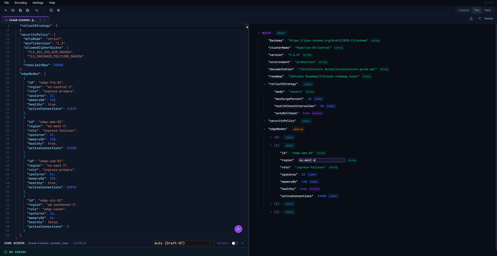
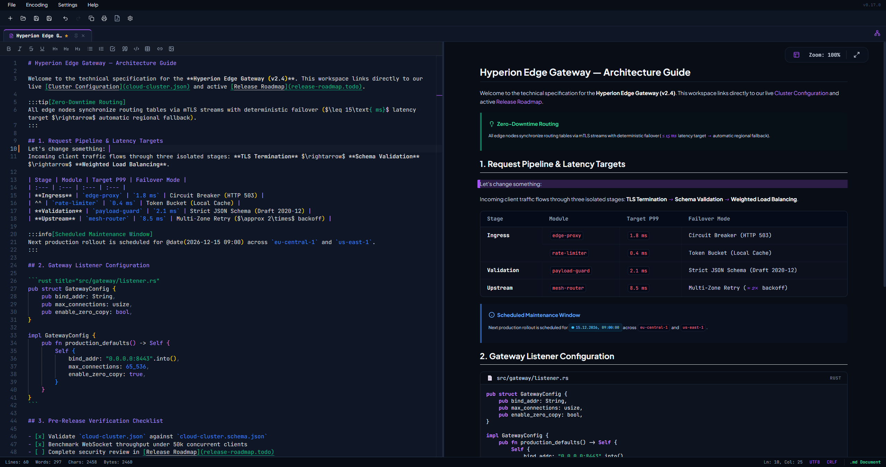
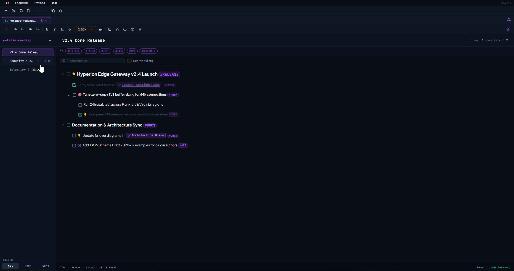

# Fileditor

**Visual Multi-Format Desktop Editor & Graph Workspace for JSON, XML, Markdown, ToDo & Text**

[](./LICENSE)
[](https://github.com/TheNativeGit/Fileditor/releases)
[](https://tauri.app)
[](https://github.com/TheNativeGit/Fileditor/releases/latest)

[Website](https://nativeproduction.de) · [Releases & Downloads](https://github.com/TheNativeGit/Fileditor/releases) · [Changelog](./CHANGELOG.md) · [Support](./SUPPORT.md) · [Third-Party Notices](./THIRD_PARTY_NOTICES.md)

---

## Overview

**Fileditor** is a fast, privacy-first desktop editor built with **Tauri v2**, **React**, and **Rust**. It combines the power of the **Monaco Editor** with interactive visual workspaces, multi-dialect schema validation, multi-list `.todo` notebooks, and a live 2D document knowledge graph — working **100% offline** with zero telemetry.

---

## Screenshots

> *Screenshots from the desktop workspace:*

| JSON & Schema Validation | Markdown Live Preview | ToDo Workspace (`.todo`) |
| :---: | :---: | :---: |
|  |  |  |

---

## Key Features

- **Visual JSON & XML Workspace**
  - Edit structured data side-by-side in **Monaco Editor** and interactive **Miller Columns**, **Tree View**, or **Table View** with instant two-way synchronization.
- **Comprehensive Multi-Schema Validation**
  - **JSON**: Supports **Draft-04**, **Draft-06**, **Draft-07**, **Draft 2019-09**, **Draft 2020-12**, and **JSON Type Definition (JTD / RFC 8927)** with automatic `$schema` dialect detection.
  - **XML**: Native Rust validation engine supporting **W3C XML Schema (XSD 1.0 / 1.1)**, **DTD** (external `.dtd` and inline `<!DOCTYPE>`), **RelaxNG XML (`.rng`)**, and **ISO Schematron (`.sch`)** via XPath rules.
  - **Drag & Drop**: Drop any schema file directly onto the bottom-left Schema panel to load and validate immediately.
- **Markdown Live Preview & Vector PDF Export**
  - Bidirectional editor/preview line & table-cell synchronization, **Docusaurus** callouts (`:::tip`, `:::info`, `:::warning`, `:::danger`, `<details>`), LaTeX math symbols, Discord/custom date badges, fullscreen reader mode with Table of Contents, and selectable vector PDF export.
- **Structured ToDo Workspaces (`.todo`)**
  - Multi-list notebooks inside a single `.todo` file, nested subtasks, priority indicators, `#HASHTAG` color filtering, and interactive cross-file `[Label](path)` / `[[wikilink]]` links.
- **Interactive 2D Document Graph**
  - Force-directed 2D graph visualizing open documents, orbiting ToDo sub-lists, and file links with instant `Ctrl + Click` navigation.
- **Multi-Window Tab Dragging & Session Recovery**
  - Smooth 60/120fps tab reordering, tear-off tabs into independent windows, cross-window tab drops, configurable session recovery backups, custom `.rgb` accent themes, and customizable keyboard shortcuts.
- **100% Offline & Privacy-First**
  - All fonts (`Plus Jakarta Sans`, `JetBrains Mono`) and Monaco Web Workers are bundled locally. No external CDN requests, no tracking, strict Content Security Policy (CSP), and `DOMPurify` HTML sanitization.
  - Built-in **cryptographically signed Auto-Updater** (`Help -> Check for Updates...`) with formatted release notes and *"Skip this version"* control (automatic startup reminder is **off** by default).
- **Multilingual Interface**
  - Full UI support for **English**, **German (`Deutsch`)**, and **Spanish (`Español`)**.

---

## Download & Installation (Windows x64)

Download the latest release from **[GitHub Releases](https://github.com/TheNativeGit/Fileditor/releases/latest)**:

1. **Installer (`Fileditor_x.y.z_x64-setup.exe`)** — Custom NSIS installer allowing either **Current User** installation (no administrator rights required) or **All Users** installation, with optional file associations.
2. **Portable (`Fileditor_x.y.z_x64-portable.zip`)** — Standalone `Fileditor.exe` requiring no installation.
3. **Checksums (`SHA256SUMS.txt`)** — Verify your download in PowerShell:
   ```powershell
   Get-FileHash .\Fileditor_*_x64-setup.exe -Algorithm SHA256
   ```

> **Note on Windows SmartScreen:** Because Fileditor is a free, non-commercial open-source hobby project without a paid commercial EV certificate (open-source signing via SignPath Foundation is planned), Windows may display *"Windows protected your PC"* on new releases until download reputation builds up. Click **More info** -> **Run anyway** after verifying that you downloaded the file from the official `https://github.com/TheNativeGit/Fileditor/releases` page.

---

## Building from Source

### Prerequisites
- **Node.js** `>= 20` and `npm`
- **Rust** (`stable` toolchain) + **Microsoft C++ Build Tools** & **WebView2** (pre-installed on Windows 10/11)

### Commands

```bash
# 1. Install dependencies
npm install

# 2. Run in development mode (Vite + Tauri desktop window)
npm run tauri dev

# 3. Run frontend TypeScript & Vite production build + Rust unit tests
npm run build
cd src-tauri && cargo test

# 4. Build optimized Windows standalone EXE & NSIS installer
npm run build:tauri
```

---

## Project Status & AI Transparency

- **Free Hobby Open-Source Project**: Fileditor is developed in spare time as a personal, non-commercial open-source project without monetization, ads, or subscriptions. It is provided **"as is"** without warranty or commercial SLA.
- **AI Transparency**: Parts of the codebase, architecture refactorings, and documentation were transparently developed and refined with the assistance of AI coding tools, reviewed and tested by the maintainer.

---

## License & Credits

- Licensed under the **[MIT License](./LICENSE)** — Copyright © 2026 [NativeProduction](https://nativeproduction.de).
- Full attributions and license notices for all open-source libraries and fonts used in Fileditor are documented in **[THIRD_PARTY_NOTICES.md](./THIRD_PARTY_NOTICES.md)** and inside the application under `Help -> About Fileditor`.
